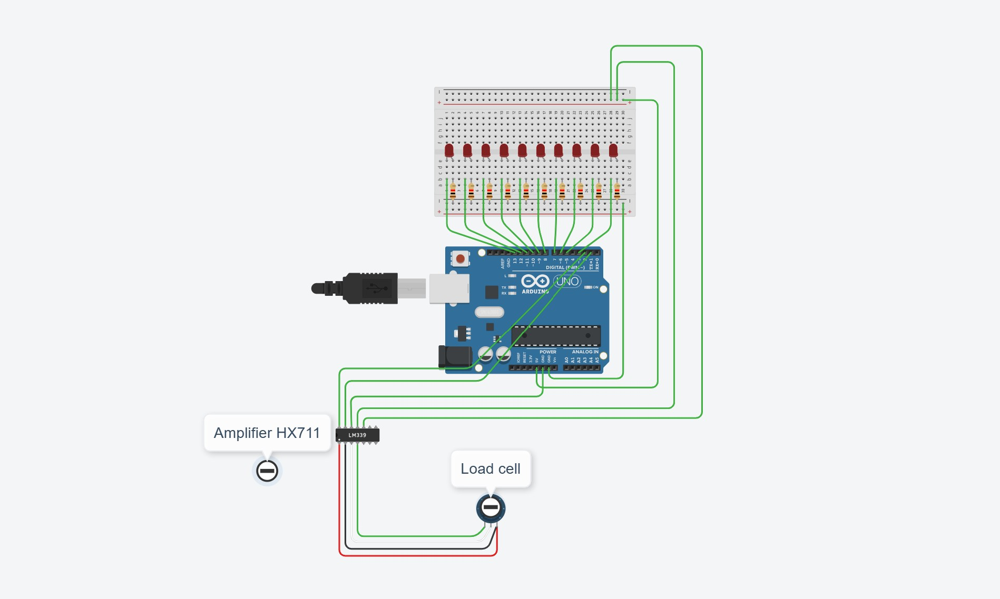

# LST Project B: Integrating force measurement system for measuring muscle activity

## 1. Introduction and description

This project implements a force measurement system based on an 
Arduino microcontroller and the HX711 load cell amplifier. 
The system is designed to accurately measure muscle force produced 
during ankle dorsiflexion.

The project is part of a broader research effort investigating muscle 
activity using magnetomyography (MMG), 
where force data serves as a complementary measurement modality.

The system enables real-time acquisition and visualization of muscle force, 
allowing subjects to perform controlled trials with different force tracking tasks. 
It supports multiple predefined force paths, trial configurations and saving of 
results. This project includes code implementations in 

1. Arduino (Arduino IDE): load cell calibration and data acquisition, 
2. Python: implementing measurement protocols and providing two different visualization paradigms.

---
## 2. Hardware and wiring

The testing device is constructed from 2×2 wooden studs and laminated wood panels. It is designed to support and position the ankle at a controlled angle during measurements. Holes have been drilled into the structure to allow angle adjustment, enabling an appropriate initial ankle position for different test subjects. The angle can be adjusted in increments of approximately 3 degrees within a range of 90 to 130 degrees, and is fixed in place using a locking mechanism. The structure is rigid and stable, ensuring consistent positioning during measurements.
All the components used are non-magentic, 
suited for the purposes of this project.

Parts used for wiring:
- Arduino Uno
- Amplifier HX711
- Two-pin LEDs 10 pcs (blue, green and red)
- Bread board
- Load cell 50 kg
- Resistors 220 ohm
- Cables

#### Circuit diagram
The circuit diagram has been created using the Tinkercad Circuits software, which does not directly support a load cell sensor or the HX711 amplifier module. For this reason, the circuit is presented as a conceptual model using similar components to represent and illustrate the connections. See Table 1 below for correct connections.



#### Table 1: Load Cell – HX711 – Arduino Connections

| Load Cell Wire | HX711 (Input) | HX711 (Output) | Arduino Connection |
|----------------|--------------|----------------|--------------------|
| Red (E+)       | RED          | GND            | GND                |
| Black (E−)     | BLK          | DAT            | Pin 3              |
| White (A−)     | WHT          | CLK            | Pin 2              |
| Green (A+)     | GRN          | VCC            | 5V                 |  
| Ground         |              | VDD            | 5V                 |
---

## 3. Software and files

The Project combines Arduino and Python components to handle data acquisition, processing, and visualization of force measurements.

### Arduino

**Calibration**
- ***Calibration.ino***  
 Script used to calibrate the load cell to measure weight in grams. It calculates
 the calibration factor using a known mass. This calibration factor is later required
 for converting raw sensor readings into accurate weight measurements.

**Measurement**
- ***Measurement.ino***  
  The main Arduino script. It reads data from the load cell using the HX711 module and
  converts it into weight using the calibration factor. Weight values are printed to the
  Serial Monitor, enabling communication with Python via serial. In addition, the script
  controls a 10-LED bar to visualize the applied force as a percentage of a predefined maximum value.

### Python

**Maximum measurement**
- ***measure_max.py***  
  Script used to determine the subject’s maximum force output. It reads force data from the Arduino via
  serial communication, visualizes it in real time, and saves the data to a CSV file. The program supports 
  multiple trials and computes the maximum force as the highest 3-second moving average for each trial, as well
  as the overall maximum across all trials.

**General measurement**
- ***plot_force_moving_background.py***  
  Script for force tracking tasks with a moving (dynamic) background. It reads force data from the Arduino via serial
  communication, visualizes the subject’s force output in real time, and saves each trial to a CSV file. The target
  follows predefined patterns (e.g., square, triangle, trapezoid, sinusoidal), which the subject attempts to match during the task.

- ***plot_force_stationary_background.py***  
  Script for force tracking tasks with a fixed (stationary) background and a predefined trial duration. It reads force data from the Arduino
  via serial communication, visualizes the subject’s force output in real time, and saves each trial to a CSV file. The target follows predefined
  patterns (e.g., square, triangle, trapezoid, sinusoidal), which the subject attempts to match during the task.
---
## 4. Setup and Usage

### 4.1 Prerequisites
- Arduino IDE (version 2.3 or newer)
- HX711 library for Arduino
- Python 3.10 or newer
- Required Python packages: pyserial, matplotlib (pyplot and animation), numpy, pandas, collections

### 4.2 Arduino setup

1. Connect the load cell to the HX711 amplifier and the HX711 to the Arduino Uno as 
described in Section 2.
2. Connect the Arduino Uno to your computer via USB.
3. Open the Arduino IDE.
4. Install the **HX711** library
5. Select the correct board and port:
    - **Tools -> Board** -> Arduino UNO
    - **Tools -> Port** -> the port the Arduino is connected to
6. The setup includes two Arduino sketches in 'arduino/' folder:
    - 'calibration.ino' - used to determine the load cell calibration factor (see section 4.4)
    - 'measurement.ino' - used during actual force measurements

    The measurement sketch must be configured with calibration factor before it is uploaded. Proceed to Section 4.4 (Calibration)
    before uploding 'measurement.ino'.

### 4.3 Python setup

1. Clone or download this repository
2. Install required packages (see section 4.1)
3. Open the max measurement and visualization scripts ('plot_force_moving_background' and 'plot_force_stationary_background')
and configure the variables in the 'main()' function:
- 'Port': the serial port your Arduino is connected to (e.g., '"/dev/cu.usbserial_XXXX"' on macOS, '"COM3"' on Windows)
- 'BAUD': baud rate (must match the Arduino sketch, default '57600')
- 'filename': name of the output CSV file (e.g., '"subject01.csv"')

**NOTE**: the visualization scripts also include 'max_value' variable in 'main()'. Set it to the maximum force value
obtained in Section 4.6.
  - 'max_value': subject-specific maximum force value in grams
4. (Visualization scripts only) Choose the target force shape by uncommenting one of the 'plot_*' lines in 'main()'.
Available shapes: 'plot_trap', 'plot_rect', 'plot_triangle', 'plot_square_sine'.

### 4.4 Calibration

For calibrating the load cell

1. Open the calibration sketch 'arduino/calibration.ino' in the Arduino IDE.
2. Upload it to the microcontroller and open Serial monitor.
3. Follow the on-screen instructions.
4. Note the calibration factor printed in the Serial Monitor.
5. Open the measurement sketch and update yhe calibration factor accordingly.
6. Upload the updated measurement sketch to the microcontroller.

### 4.5 Running a measurement


### 4.6 Maximum force measurement

Each subject's maximum voluntary force is measured before the actual trials.
This value is used to scale the target force path in the visualization scripts.

1. **Close the arduino IDE Serial Monitor** if it is open.
2. Open 'measure_max.py' 
   - make sure that 'PORT' and 'BAUD' are configured
3. Run the script:
'''bash
   python measure_max.py
'''
4. A figure window opens.  Click the window and press **SPACE** to start a new trial. 
Each trial lasts 15 secponds, during which the subject performs a maximum dorsiflexion against the load cell.
5. After the trial ends automatically, the script prints two values:
   - 'trial_max': the peak 3-second average force for the most recent trial
   - 'total_max': the highest 'trial_max' across all trials in this sessions
5. Repeat the trial by pressing **SPACE** again. The results are saved to the CSV file specified in 'filename'.
The final 'max_force_total' value (in grams) is the maximum voluntary force for this subject.
6. Close the figure window when finished. The results are saved to the CSV file specified in 'filename'.
7. Use this value as 'max_value' in the visualization scripts (see Section 4.3)

### 4.7 Visualization

The system provides two visualization paradigms:
- **Moving background paradigm**: the window scrolls with the cursor, showing the upcoming target path.
Trials run continuously until the user starts a new one.
- **Stationary background paradigm**:the full target path is visible at once, and the cursor moves across it.
Each trial ends automatically after 65 seconds.

To run a measurement:
1. Make sure the Arduino sketch has been uploaded to the microcontoller (see Section 4.3).
2. **Close the Arduino IDE Serial Monitor** if it is open (otherwise Python cannot access the serial port.)
3. Choose the visualization paradigm by running the corresponding script:

- **Moving background paradigm:**
```bash
     python plot_force_moving_background.py
```
- **Stationary background paradigm:**
```bash
     python plot_force_stationary_background.py
```
4. A figure window opens showing the target force path. Click the window and press **Space** (in the stationary paradigm)
or **ENTER** (in the moving paradigm) to start a trial.
5. Measurement  results are saved automatically to the CSV file specified in 'filename'.
The file is in the same folder as the script and contains time, measured force,
and targer force values. Multiple trials are appended to the same file
with 'Trial_1', 'Trial_2', etc. headers.
---
## 5. Contributions

Oiva Kylmä,
Teemu Hartikainen,
Petra Häggqvist,
Erin Karjalahti,
Jenny Ruokolainen and
Villa Mustajoki
---   

    
